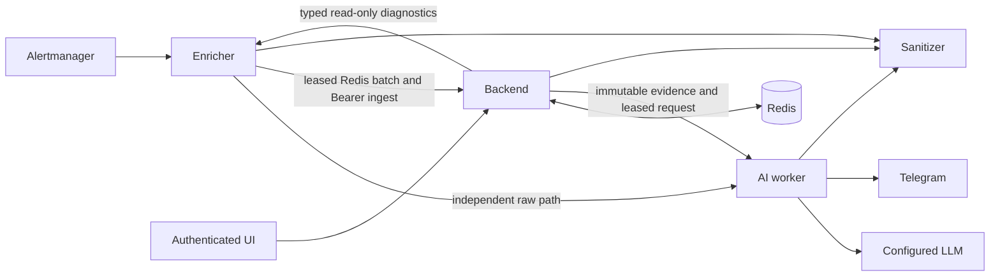

# IncidentGPT Architecture

IncidentGPT consists of four Go components and a React UI:

- `enricher`: receives Alertmanager webhooks, enriches alerts with Prometheus and Kubernetes context, buffers related alerts in Redis and sends incidents to `ai-worker`.
- `backend`: persists incidents/evidence/knowledge in Redis and serves authenticated investigation/report workflows.
- `sanitizer`: HMAC-authenticated, fail-closed data boundary before configured destinations and new feature persistence.
- `ui`: React pages served by nginx with shared-admin Basic authentication and API proxying.
- `ai-worker`: posts raw alerts to Telegram, calls an OpenAI-compatible chat completions endpoint and publishes an engineering draft analysis.

IncidentGPT does not make autonomous remediation decisions. It creates a draft for engineers; a human makes the final decision.

## HTTP Endpoints

### Enricher

- `GET /healthz`: returns `ok`.
- `GET /readyz`: validates local readiness checks.
- `GET /status`: returns configured service/dependency status.
- `GET /metrics`: exposes application metrics.
- `POST /alert`: accepts either an Alertmanager webhook object with `alerts` or a raw `[]AMAlert`.

Default listen address: `:9099`.

### AI Worker

- `GET /healthz`: returns `ok`.
- `GET /readyz`: validates required config and provider URL.
- `GET /status`: returns OpenRouter, Telegram and runtime status.
- `GET /metrics`: exposes application metrics.
- `POST /incident`: single enriched alert; posts raw alert, returns, then starts asynchronous LLM analysis.
- `POST /incident-raw`: raw/live alert path used while a Redis group is still settling.
- `POST /incident-group`: grouped incident path used after Enricher flushes a Redis group.

Default listen address: `:8080`.

## Legacy payload flow (default)

1. Prometheus evaluates alert rules.
2. Alertmanager sends a webhook to Enricher `POST /alert`.
3. Enricher creates `EnrichedAlert` with labels, annotations, severity, fingerprint and timestamps.
4. Enricher queries Prometheus `/api/v1/query_range`.
5. Enricher reads Kubernetes pods, nodes, namespaces and events when in-cluster credentials are available.
6. Enricher writes firing alerts to Redis key `grp:{namespace}`.
7. The first alert starts a local debounce timer for `CORR_SETTLE`.
8. On flush, Enricher reads `HGETALL`, deletes the group key and posts to `GROUP_BACKEND_URL`.
9. AI Worker posts raw alerts and group summaries to Telegram.
10. AI Worker calls OpenRouter or another OpenAI-compatible endpoint.
11. The model response is posted as an engineering draft.

## Redis Keys

- Key: `grp:{namespace}`.
- Fallback group when namespace is missing: `grp:_nolabel`.
- Field: alert fingerprint.
- Value: JSON encoded `EnrichedAlert`.
- TTL: `CORR_WINDOW`.

Resolved alerts are removed from the group and sent individually.

## Prometheus Requests

Enricher uses `GET /api/v1/query_range` with:

- `query`: primary alert expression from `generatorURL` or annotations, plus configured metric templates.
- `start`: `startsAt - PROM_RANGE_BEFORE`.
- `end`: `startsAt + PROM_RANGE_AFTER`.
- `step`: approximately one sixtieth of the range, with a minimum of 15 seconds.

Configured metric templates are rendered with Go `text/template` placeholders such as `{{ .Namespace }}`, `{{ .Cluster }}`, `{{ .Service }}`, `{{ .Node }}` and `{{ .Instance }}`.

## Kubernetes Permissions

The Enricher chart creates a ServiceAccount, ClusterRole and ClusterRoleBinding. The ClusterRole grants:

- core API: `pods`, `namespaces`, `nodes`, `events` with `get`, `list`, `watch`;
- apps API: `deployments`, `replicasets` with `get`, `list`.

The code uses in-cluster config. If Kubernetes client initialization or reads fail, Enricher logs warnings and continues without Kubernetes context.

## Telegram Flow

AI Worker uses Telegram `sendMessage` through `https://api.telegram.org/bot<TOKEN>/sendMessage`.

Current code posts replies to `TELEGRAM_CHANNEL_ID`; Telegram shows comments in the linked discussion group when the channel is configured that way.

## LLM Flow

AI Worker posts a chat completions request to `OPENROUTER_BASE_URL` with:

- `model`;
- `max_tokens`;
- `messages` with system and user prompts.

The default endpoint is `https://openrouter.ai/api/v1/chat/completions`.

## Failure Scenarios

- Redis unavailable: Enricher falls back to direct single-alert sends.
- Prometheus unavailable: query warnings are logged and remaining context is still used.
- Kubernetes API unavailable: Enricher continues without Kubernetes context.
- Telegram unavailable: synchronous sends return `telegram_error`; asynchronous failures are logged.
- LLM unavailable: raw alert remains available; analysis is skipped and the error is logged.

## Known Limitations

- Correlation is namespace plus time window, not a dependency graph.
- Debounce timers are local to each Enricher process.
- There is no durable queue between Enricher and AI Worker.
- There is no full idempotency contract for webhook redelivery.
- LLM output can be wrong and must be verified by humans.

## Optional durable investigation flow

The diagram shows logical calls; external payloads cross sanitizer boundaries before
LLM/Telegram. Durable mode replaces process-local batch deadlines with persisted
due sets, atomic pending snapshots, leases, bounded retries and explicit acknowledgement.
Arrivals during handoff remain in a separate pending hash. Backend schedules jobs
with immutable input/evidence and only the requested analysis version can become
current. Leased collectors append fresh evidence once; cancellation fences publication.
Legacy callbacks by group are rejected when durable mode is active. Telegram remains
best effort/at least once, not exactly once. Basic visibility does not require an LLM.

Contracts and APIs are detailed in [the six guides](../README.md#evidence-durable-jobs-and-investigation-workflows).
Key families include `igpt:change:*`, indexed change windows; `igpt:corr:*`, pending
and delivery batches; `igpt:job:*`, due/ownership state; `igpt:evidence:*` and immutable
analysis histories; `igpt:resolution:*`, authoritative confirmed-memory indices;
`igpt:graph:*`, typed topology/provenance; `igpt:regroup:*`, composition audit and
manual binding; `igpt:lifecycle:*`, distinct source/receipt/human verification events;
and `igpt:report:*`/`igpt:reports:*`, reviewed revisions and retained snapshots.

Graph ownership, placement and declared application dependencies remain separate.
Correlation uses one fresh declared dependency at most and never infers service
health or cause. Human moves retain old source pages and invalidate current analysis
composition. Report jobs reuse the queue but generate deterministic cited Markdown
from a sanitized snapshot, without an additional LLM call or notification.

New reads use finite indexed candidates; some original incident/alert/volume/source
list handlers still scan old records. New features require Redis rather than hiding
persistence failure behind the legacy in-memory fallback. The shipped single Redis
node is not HA; enable persistence/AOF, monitor queues/coverage, back up records and
plan retention for non-expiring incident/job/audit histories. Multi-key Lua assumes
one primary and is not compatible with Redis Cluster key-slot sharding.

Deploy additive readers/contracts first; drain legacy groups before switching
producers. Roll back in reverse workflow order: stop reports/diagnostics, drain
analysis and durable correlation, disable topology/change collectors, then revert
consumers. Preserve additive records and acknowledge documented AOF/disk loss windows.
No historical timestamps or collector coverage are fabricated during migration.
